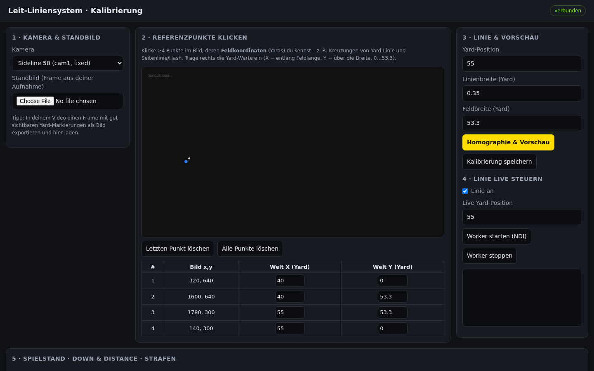

# Football Leit-Liniensystem

Virtuelle **First-Down-Line** („gelbe Linie") für American-Football-Produktionen mit **VMix** und **Blackmagic**, gesteuert über einen **Node.js-Server** oder eine **PySide6-Desktop-App** und gerendert mit einer **Python/OpenCV**-Engine. Die Engine erzeugt einen _zusätzlichen_ NDI-Feed (`LINE-CAMx`) und blockiert die bestehenden Feeds nicht.


> Status: Scaffold / Proof-of-Concept. Der Offline-Pfad (Video-Datei rein → Linie mit Perspektive + Okklusion → Video/Fenster raus) läuft ohne Spezial-Hardware. Der Live-Pfad (NDI/DeckLink) ist verdrahtet, aber laut Roadmap noch nicht real getestet.

## Screenshot



## Features

- **First-Down-Line** (gelb) und **Line of Scrimmage** (blau) – perspektivisch korrekt und *hinter* den Spielern (HSV-Rasen-Keying).
- **Team-Logos auf dem Rasen** (PNG mit Alpha, gewarpt, ebenfalls okkludiert).
- **Game-State**: Down & Distance, Ballbesitz, Strafen; Scorebug und Strafen-Banner im Feed; optionaler Push an einen VMix-GT-Title (`SetText`).
- **Multi-Kamera**: je Kamera eigene Pipeline, eigene Kalibrierung, optionales Tracking (ORB + RANSAC) und eigener NDI-Ausgang.
- **Zwei Bedienoberflächen** auf derselben Engine: Desktop-App (Zwei-Monitor-Layout, PREVIEW | TAKE | PROGRAM, Multiview) und Web-Control (Kalibrierung, Spielstand, Worker-Steuerung).
- Eingänge: Datei, Capture-Device (`device:0`, z. B. DeckLink/USB), NDI. Ausgänge: Fenster, Datei, NDI.

## Tech-Stack

| Bereich | Technik |
|---|---|
| Control-Plane | Node.js ≥ 18, Express 4, ws (WebSocket) |
| Data-Plane | Python, OpenCV, NumPy, Pillow |
| Desktop-App | PySide6 (Qt) |
| Web-UI | Vanilla JS + Canvas |
| Live-I/O (optional) | NDI über `cyndilib` |

## Schnellstart

### Voraussetzungen

- Python 3 (Version nicht im Repo festgelegt) und Node.js ≥ 18
- Linux zusätzlich (für Qt): `libegl1 libgl1 libxkbcommon0`
- Optional: `cyndilib` für NDI

### Installation

```bash
python -m venv .venv && source .venv/bin/activate
pip install -r worker/requirements.txt -r app/requirements.txt
npm install
cp config/example.config.json config/config.json
# eigene Aufnahme z. B. als recordings/cam1.mp4 ablegen
```

### Start

**Desktop-App**

```bash
python app/main.py
```

**Web-Control + Worker**

```bash
npm start            # http://127.0.0.1:3000
python worker/line_engine.py --config config/config.json --camera cam1 --sink window
```

**Live (NDI)**

```bash
pip install cyndilib
python worker/line_engine.py --config config/config.json --camera cam1 \
  --source-override "ndi://KAMERA-PC (Cam 1)" --sink ndi
```

In VMix den neuen NDI-Sender `LINE-CAM1` als Input hinzufügen.

## Konfiguration

| Variable | Standard | Bedeutung |
|---|---|---|
| `HOST` | `127.0.0.1` | Bind-Adresse des Node-Servers |
| `PORT` | `3000` | Port des Node-Servers |
| `PYTHON_BIN` | `python3` | Python-Interpreter für gestartete Worker |

Feldmodell, Kameras, Overlays, Teams und Logos stehen in `config/config.json` (Vorlage: `config/example.config.json`). Details: [docs/KONFIGURATION.md](docs/KONFIGURATION.md).

## Projektstruktur

```
.
├── app/        # Desktop-App (PySide6): main, engine (QThread), manager, theme
├── server/     # Node.js Control-Plane: index, config, homography, vmix, workers
├── web/        # Browser-UI (index.html, app.js, style.css)
├── worker/     # Python/OpenCV: line_engine, render, homography, occlusion,
│               #   graphics, hud, tracking, io_sources, io_sinks
├── config/     # example.config.json (+ Laufzeitdateien)
├── assets/     # Team-Logos (PNG mit Alpha)
└── docs/       # Dokumentation
```

## Dokumentation

- [Architektur](docs/ARCHITEKTUR.md)
- [Installation](docs/INSTALLATION.md)
- [Konfiguration](docs/KONFIGURATION.md)
- [Entwicklung](docs/ENTWICKLUNG.md)
- [API](docs/API.md)
- Bestehend: [docs/ARCHITECTURE.md](docs/ARCHITECTURE.md) (Originaltext des Autors) und [docs/ROADMAP.md](docs/ROADMAP.md)

## Hinweis zu Logos

Team-Logos werden aus Rechtegründen nicht eingecheckt; eigene PNGs gehören nach `assets/` (siehe `assets/README.md`).
