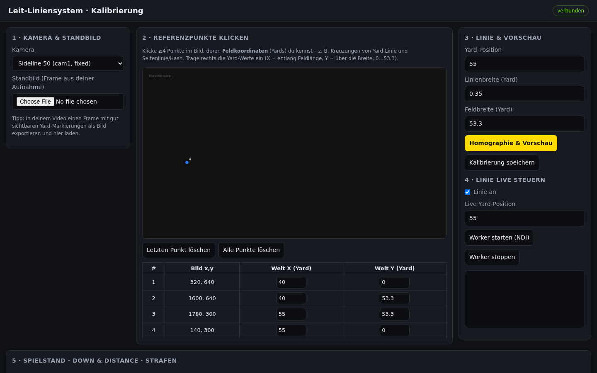
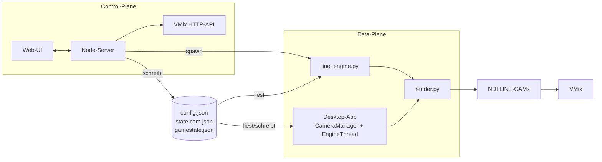
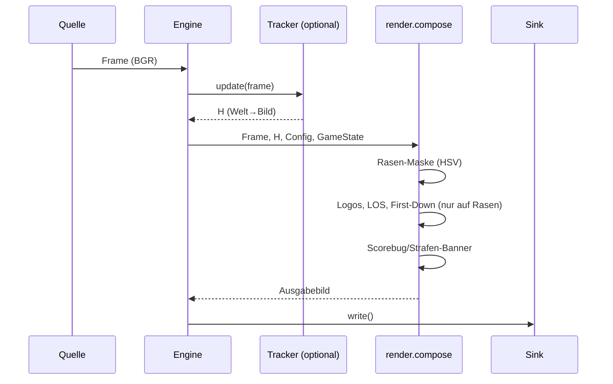

# Architektur

[← Zurück zur README](../README.md)

Ergänzend zum ausführlichen Originaltext in [ARCHITECTURE.md](ARCHITECTURE.md) und der [Roadmap](ROADMAP.md).

## Überblick

Strikte Trennung in **Control-Plane** (Node.js: UI, Config, Prozess-Management, VMix-API) und **Data-Plane** (Python/OpenCV: Homographie, Okklusion, Compositing, I/O). Zwei Frontends (Desktop-App, Web-UI) nutzen dasselbe Render-Modul `worker/render.py` und dieselben Dateien, damit die Ausgabe identisch bleibt.

## Komponenten

| Komponente | Pfad | Aufgabe |
|---|---|---|
| Control-Server | `server/index.js` | Express + WebSocket, REST-API, statische Web-UI |
| Config/State | `server/config.js` | Lesen/Schreiben von `config.json`, `state.<cam>.json`, `gamestate.json` |
| Worker-Steuerung | `server/workers.js` | Startet/stoppt je Kamera einen Python-Prozess |
| VMix-Client | `server/vmix.js` | HTTP-API (Port 8088): Overlay, Cut, SetText, SetImage |
| Homographie-Preview | `server/homography.js` | DLT-Löser für die Browser-Vorschau |
| Web-UI | `web/` | Kalibrierung per Klick, Spielstand, Worker-Steuerung |
| Desktop-App | `app/` | `main.py` (Einstieg), `manager.py` (CameraManager), `engine.py` (QThread je Kamera), `theme.py` |
| CLI-Engine | `worker/line_engine.py` | Headless-Schleife je Kamera |
| Render | `worker/render.py` | Logos → LOS (blau) → First-Down (gelb) → Scorebug |
| CV-Module | `worker/homography.py`, `occlusion.py`, `graphics.py`, `hud.py`, `tracking.py` | Geometrie, Rasen-Maske, Logos, Overlays, ORB-Tracking |
| I/O | `worker/io_sources.py`, `io_sinks.py` | Datei/Device/NDI rein; Fenster/Datei/NDI raus |

## Komponentendiagramm

## Datenfluss pro Frame

## Kernideen

- **Homographie**: Feldkoordinaten (Yards, X = Länge 0…120, Y = Breite 0…53,3) werden mit ≥ 4 Kalibrierpunkten auf Bildpixel abgebildet.
- **Okklusion**: Gezeichnet wird nur, wo Linie **und** Rasen-Maske gesetzt sind; Spieler sind nicht grün, daher liegt die Linie scheinbar darunter.
- **Tracking**: `PitchTracker` verkettet Frame-zu-Frame-Homographien (ORB + RANSAC). Drift ist bekannt; `reanchor()` ist ein offener Hook.
- **Preview/Program** (App): Der Engine-Thread rendert aus demselben Frame zwei Bilder (Preview-State und Program-State); TAKE übernimmt Preview nach Program.
- **Kommunikation über Dateien**: Der Worker pollt State-Dateien alle N Frames (`--state-poll`); kein Socket nötig.

## Betriebsnotizen

- Ein Worker-Prozess pro Kamera (Isolation).
- Server bindet standardmäßig nur auf `127.0.0.1`.
